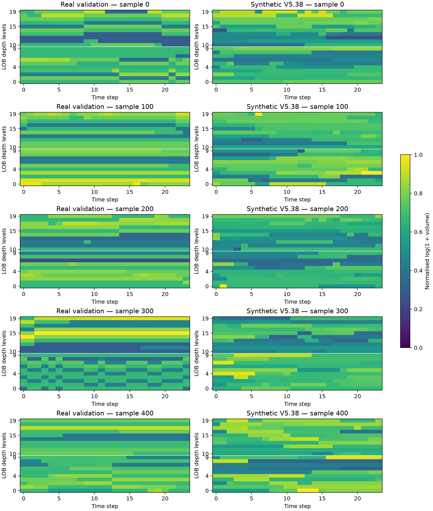
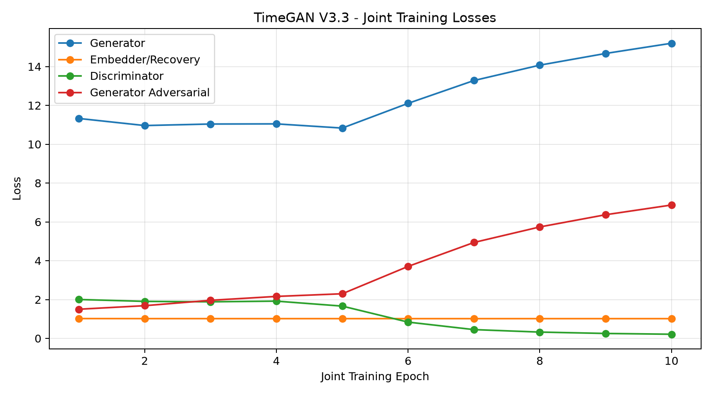
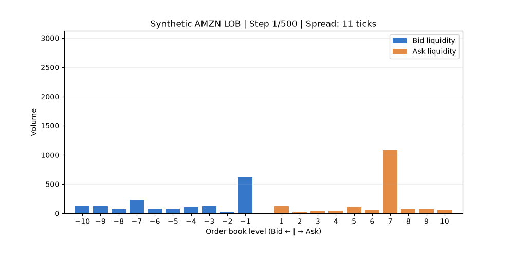

# Time-Series Generation: TimeGAN for Limit Order Book Simulation

**COMP3710 — Pattern Recognition and Analysis (2026)**
**Student ID:** 49839339
**UQ Username:** s4983933
**Project 7 — Hard Difficulty**

## 1. Project Overview

This project investigates the generation of synthetic financial limit order book (LOB) time series using TimeGAN and a hybrid probabilistic modelling framework.

The objective is to produce synthetic sequences that preserve both the structural validity of financial order books and the statistical characteristics of real market activity.

The final implementation combines:

- A recurrent TimeGAN backbone for learning temporal latent representations.
- A constraint-aware price decoder for constructing ordered bid and ask levels.
- A multi-factor volume head for initial liquidity generation.
- A probabilistic mixture-density model for temporal depth dynamics.
- Markov models for discrete price returns and bid-ask spread transitions.

The project evaluates whether these components improve upon a conventional TimeGAN and an empirical training-data replay baseline.

## 2. Dataset and Preprocessing

The project uses the supplied LOBSTER AMZN Level-10 limit order book dataset [2].

Each observation contains 41 features:

- Ten ask-price levels.
- Ten ask-volume levels.
- Ten bid-price levels.
- Ten bid-volume levels.
- One log-return feature.

The input sequence length is 24 observations.

The dataset is divided into chronological training, validation and test subsets:

| Split | Sequences | Shape |
|---|---:|---|
| Training | 7,867 | (7867, 24, 41) |
| Validation | 1,685 | (1685, 24, 41) |
| Test | 1,685 | (1685, 24, 41) |

The model is trained on the training partition, while validation data supports model development and selection. The test partition is reserved for final evaluation.

The implementation uses a consistent normalization and inverse-transformation pipeline, with price, volume and return characteristics evaluated in their appropriate representations.

### 2.1 Detailed Preprocessing Pipeline

The final preprocessing pipeline is implemented in `dataset.py`, primarily through `RelativeOrderBookTransform`, `MixedLOBNormalizer`, and `prepare_dataset_v4`.

**Price representation.** Raw LOBSTER prices are converted from their integer-scaled representation by dividing by 10,000. Order-book price features are represented relative to a midpoint reference, allowing the model to focus on market structure rather than absolute stock-price levels.

**Volume transformation.** Order quantities are transformed using `log1p` to reduce the effect of large volume magnitudes. The corresponding inverse transformation uses `expm1`.

**Return transformation.** The additional return feature is normalised separately from the 40 order-book features. The implementation uses an `arcsinh` transformation scaled using the median magnitude of nonzero training returns, followed by training-derived standardisation.

**Leakage prevention.** Observations are split chronologically into 70% training, 15% validation and 15% testing before normalisation parameters are fitted. The normaliser is fitted exclusively on training observations and then applied unchanged to validation and test observations.

**Sequence construction.** Each split is converted into fixed-length windows. The default sequence length and stride are both 24, producing non-overlapping windows without crossing the chronological split boundaries.

This design reduces information leakage and supports a consistent evaluation of the generated data against held-out market observations.

## 3. Model Architecture

### 3.1 TimeGAN Backbone

The TimeGAN backbone uses recurrent neural networks to learn temporal representations, following the TimeGAN framework proposed by Yoon et al. [1].

The architecture contains five components:

1. Embedder
2. Recovery network
3. Generator
4. Supervisor
5. Discriminator

The embedder and recovery network support representation learning, while the generator and supervisor participate in synthetic sequence generation.

### 3.2 Constraint-Aware Price Generation

A dedicated price head constructs ordered bid and ask levels, enforcing positive spreads and monotonic price ladders.

The final system uses a dynamically evolving midpoint, rather than requiring bid and ask prices to remain on fixed sides of a zero-valued reference.

### 3.3 Liquidity and Depth Generation

A multi-factor volume head produces initial liquidity profiles.

A probabilistic mixture-density network then models evolving order-book depth, allowing stochastic volume dynamics across time.

### 3.4 Markov Return and Spread Models

Discrete Markov models are used to generate realistic return activity and bid-ask spread transitions.

These components address statistical limitations observed in earlier direct TimeGAN outputs.

### 3.5 Final Hybrid Generation

The final V5.38 pipeline combines neural representations, constrained price reconstruction, probabilistic depth generation, and Markov dynamics.

The resulting output has shape:

`(number_of_sequences, sequence_length, 41)`

## 4. Experimental Design

The experimental evaluation compares:

- Empirical training-window replay.
- Early V4.3 TimeGAN.
- V5.10 constrained TimeGAN.
- V5.11 hybrid return model.
- Final V5.38 integrated model.

The evaluation considers:

- Bid-ask spread distribution.
- Log-return distribution.
- Market structure validity.
- Liquidity depth distributions.
- Temporal autocorrelation.
- Depth heatmap structural similarity.
- Long-horizon generation stability.
- Computational cost.

Detailed quantitative results, comparisons, limitations, and reproducibility instructions are provided in the following sections.


## 5. Quantitative Evaluation and Baseline Comparison

### 5.1 Unified Evaluation Protocol

The final comparison uses the first 512 sequences of the chronologically held-out test partition. Each sequence contains 24 observations and 41 features.

All reported models are assessed using a consistent evaluation script (`benchmark_v5_47.py`), including KL divergence for spread and returns, depth heatmap SSIM, and structural validity checks.

The KL divergence is calculated as KL(real || generated) using 80-bin histograms with shared numerical ranges. Because KL estimates depend on histogram discretisation and the representation of near-zero returns, these values should be interpreted under the stated evaluation protocol rather than as estimator-independent measurements.

### 5.2 Baseline Comparison

| Method | Spread KL ↓ | Return KL ↓ | Depth SSIM ↑ | Market Validity ↑ |
|---|---:|---:|---:|---:|
| Empirical replay | 0.1287 | 0.0142 | 0.0725 | 100% |
| V4.3 TimeGAN | 20.2882 | 2.3823 | 0.1593 | 0% |
| V5.10 TimeGAN | 19.6924 | 2.5060 | 0.1586 | 100% |
| V5.11 hybrid | 19.6924 | 0.0458 | 0.1586 | 100% |
| **V5.38 final** | **0.1132** | **0.0064** | **0.0846** | **100%** |

The final model substantially improves spread and return distribution matching compared with earlier TimeGAN-based approaches.

Compared with empirical training-window replay, V5.38 achieves lower spread KL and return KL. However, its depth heatmap SSIM remains low, indicating that improvements in marginal price dynamics do not automatically imply realistic joint liquidity structure.

Empirical replay is a useful distributional reference but copies observed training sequences rather than generating genuinely new order-book dynamics.

### 5.3 Market Structure Validity

The final system preserves the following tested structural constraints:

- Positive bid-ask spreads.
- Minimum tick-sized price separation, with numerical tolerance.
- Strictly increasing ask-price ladders.
- Strictly decreasing bid-price ladders.
- Nonnegative liquidity volumes.
- Finite numerical outputs.

The final V5.38 model achieves **100% validity under the tick-aware market structure evaluation**.

An earlier benchmark reported 99.63% validity because it required the best ask to be above zero and the best bid below zero. This zero-centred condition is not appropriate for the final model, which represents prices relative to a fixed reference while allowing the midpoint to evolve dynamically.

The original result is retained for transparency rather than silently replaced.

### 5.4 Target Achievement

The project specifies target values of KL ≤ 0.1 for spread and mid-price return distributions, and depth heatmap SSIM > 0.6.

On the final test protocol:

- Spread KL = **0.1132**: target not achieved.
- Return KL = **0.00638**: target achieved.
- Unpaired depth SSIM = **0.0846**: target not achieved.

The results therefore demonstrate significant improvements, but do not support a claim that every quantitative target was met.

## 6. Depth Structure and Qualitative Analysis

### 6.1 Real versus Synthetic Depth Heatmaps

Five representative real-validation and synthetic depth heatmaps were generated using 20 price levels and 24 temporal observations.

The heatmaps use log-transformed liquidity volumes and a shared real-data intensity scale.

The comparison reveals that both real and synthetic sequences contain persistent horizontal depth structures, but generated liquidity can exhibit different temporal variation and cross-level organisation.

These sequences are independently generated rather than paired predictions. Therefore, individual real and synthetic images should not be interpreted as pixel-aligned reconstruction targets.

### 6.2 Quantitative Depth Diagnostics

The following diagnostics compare 512 real-validation sequences and 512 synthetic V5.38 sequences.

| Metric | Real | V5.38 |
|---|---:|---:|
| Mean volume | 161.5361 | 147.4290 |
| Mean absolute temporal change | 17.3436 | 20.4003 |
| Coefficient of variation of level means | 0.2481 | 0.2393 |
| Mean absolute cross-level correlation | 0.0470 | 0.0646 |
| Mean level-wise lag-1 autocorrelation | 0.9065 | 0.8862 |

The generated order book underestimates average liquidity by approximately 8.7%, while exhibiting approximately 17.6% larger absolute temporal changes.

Several intermediate bid-depth levels are notably underestimated. For example, the real mean volume at Bid Level 6 is approximately 217.20, compared with 162.32 for the generated data.

These findings indicate that the model captures aspects of liquidity persistence but does not fully reproduce depth-specific distributions and temporal dependencies.

### 6.3 SSIM Reliability and Interpretation

A repeated random-pairing experiment was performed using the same depth image representation and normalisation as the unified benchmark. Structural Similarity Index Measure (SSIM) follows Wang et al. [3].

| Comparison | Mean SSIM | Standard deviation across 20 repeats |
|---|---:|---:|
| Real versus itself | 1.0000 | 0.0000 |
| Real versus independent real | 0.1236 | 0.0061 |
| Real versus V5.38 | 0.0817 | 0.0050 |

These results show that even independently sampled real order books have low image-level SSIM.

Consequently, randomly paired SSIM is not an equivalent measure of reconstruction accuracy or full distributional fidelity for unconditional sequence generation.

Nevertheless, V5.38 remains below the independently paired real-data reference, indicating genuine residual discrepancies in generated depth structure.

The prescribed SSIM threshold of 0.6 is not achieved under the current unpaired evaluation protocol.

## 7. Long-Horizon Generation and Failure Analysis

### 7.1 Extended 500-Step Generation

Although the primary evaluation uses 24-step sequences, the final generator was also tested on 500-step sequences.

A batch of 32 independently generated sequences, each containing 500 observations, was produced while maintaining the tested market structure constraints.

This experiment investigates how the hybrid generation process behaves beyond the original training-window length.

### 7.2 Long-Term Liquidity Drift

The mean total depth across the first 100 observations was approximately 3,394.9, compared with 4,118.8 over the final 100 observations.

Across 32 sequences:

- The mean per-sequence relative change was approximately +31.4%.
- The median relative change was approximately +24.7%.
- 21 of 32 generated sequences had increasing total depth.
- 17 of 32 increased by more than 20%.
- Six sequences decreased by more than 20%.

This indicates a tendency toward depth drift in the generated long-horizon sample.

However, comparable long continuous real-market sequences were not evaluated under this protocol, so this experiment does not establish that the drift is systematically greater than in real trading data.

### 7.3 Representative Limitations

**Liquidity underestimation.** The final model underestimates overall mean depth and several intermediate bid-price levels.

**Temporal dependence mismatch.** Synthetic volumes exhibit greater short-term changes and slightly weaker lag-1 persistence.

**Cross-level dependency mismatch.** The average absolute correlation across depth levels differs from the real reference.

**Long-horizon stability.** Extended rollout demonstrates potential liquidity drift beyond the 24-step training window.

**Incomplete statistical targets.** The final spread KL and depth SSIM do not satisfy the stated targets.

Together, these limitations show why correct price ordering and realistic one-dimensional statistics are necessary but insufficient for fully realistic financial time-series simulation.

### 7.4 Failure Case Autopsies

#### Case 1: Spread Distribution Mismatch

**Observed evidence:** The final V5.38 spread KL divergence was 0.113217, exceeding the acceptance target of 0.1, despite the tested order books satisfying tick-aware market structure constraints.

**Diagnosis:** Enforcing positive, tick-aligned spreads does not guarantee an accurate spread probability distribution. The statistical spread generator retains a measurable discrepancy from the held-out market data.

**Impact:** Simulations may misrepresent transaction costs and liquidity conditions, even when generated price ladders are structurally valid.

**Possible improvement:** Refine spread transition modelling and calibrate conditional spread distributions using training and validation data only.

#### Case 2: Depth Heatmap Similarity

**Observed evidence:** Unpaired real-versus-synthetic depth SSIM was 0.084644, below the proposed 0.6 target. In the separate reliability experiment, random real-versus-real pairs also showed low SSIM (mean 0.123555).

**Diagnosis:** The generated liquidity patterns differ from real samples, but SSIM between independent windows also penalises legitimate sample-to-sample variability. This makes the original threshold difficult to interpret as a standalone realism measure.

**Impact:** The depth generator cannot be considered to have met the SSIM target, while the low score alone does not quantify all aspects of statistical realism.

**Possible improvement:** Combine unpaired SSIM with level-wise distribution metrics, temporal autocorrelation and cross-level correlation comparisons. Reconsider the acceptance threshold using real-versus-real reference distributions.

#### Case 3: Liquidity Level and Temporal Dynamics

**Observed evidence:** Real mean volume was 161.54 versus 147.43 for the synthetic model. Mean absolute temporal volume change was 17.34 for real data and 20.40 for synthetic data. The mean level-wise lag-1 autocorrelation was 0.9065 for real data and 0.8862 for synthetic data.

**Diagnosis:** The volume component captures some persistence but does not jointly match mean liquidity, temporal variation and autocorrelation. Multi-objective training may involve trade-offs among these targets.

**Impact:** A downstream market simulator could encounter inaccurate depth availability or overly reactive liquidity changes.

**Possible improvement:** Investigate level-specific volume calibration, conditional temporal modelling and more balanced validation objectives.

#### Case 4: Long-Horizon Liquidity Drift

**Observed evidence:** In 32 generated sequences of 500 time steps, mean total depth increased from approximately 3,394.9 in the first 100 steps to 4,118.8 in the last 100 steps. Seventeen sequences increased by more than 20%.

**Diagnosis:** Repeated sequence generation may accumulate distributional deviations outside the 24-step training horizon. This remains a hypothesis because matched 500-step real-market controls were not evaluated.

**Impact:** Long-running simulations could develop unrealistic liquidity regimes even when individual order-book snapshots remain structurally valid.

**Possible improvement:** Evaluate matched real-market long sequences, perform horizon-dependent distribution checks and investigate explicit long-horizon conditioning or stabilisation.

### 7.5 Engineering Recommendation

**Recommendation: Continue research development; do not deploy for live trading or high-stakes financial decision-making.**

The V5.38 hybrid TimeGAN generator demonstrates technical feasibility for synthetic limit order book generation. It produces structurally consistent ten-level order books under the tested tick-aware validation rules and achieves a held-out mid-price return KL divergence of 0.006378, below the target of 0.1.

However, two important acceptance criteria remain unmet: spread KL divergence is 0.113217 (target <= 0.1), and unpaired depth SSIM is 0.084644 (proposed target > 0.6). Liquidity statistics also reveal mismatches in depth levels and temporal variation. Extended 500-step generation shows potential long-horizon liquidity drift, although a matched real-market long-sequence comparison has not yet been performed.

**Recommended next steps:**

1. Calibrate conditional spread generation to improve spread distribution matching.
2. Improve depth modelling using level-specific statistics, temporal dependence and cross-level correlations.
3. Reassess unpaired SSIM against real-versus-real reference distributions, rather than treating 0.6 as an independently validated threshold.
4. Evaluate long-horizon synthetic and real sequences under identical protocols.
5. Expand evaluation beyond the single-day AMZN sample before considering deployment.

**Deployment decision:** The current prototype is suitable for exploratory research, controlled comparisons and further model development. It is not yet validated as a reliable substitute for real market data in trading strategy evaluation, risk management or production execution systems.

## 8. Computational Cost and Environment

### 8.1 Software Environment

The final CPU evaluation was carried out on a Rangpur Linux environment using:

- Python 3.11.13.
- PyTorch 2.11.0+cu128.
- Four CPU threads.
- CPU execution, with CUDA unavailable on the tested login node.

### 8.2 Model Parameter Counts

| Component | Network weight elements |
|---|---:|
| TimeGAN Generator | 9,024 |
| TimeGAN Supervisor | 4,200 |
| Price Head | 24,823 |
| MultiFactor Volume Head | 540 |
| Depth MDN | 45,000 |
| **Total inference network weights** | **83,587** |

The complete TimeGAN training architecture contains 37,698 network parameters, including components not used during inference.

Additional Markov model statistics are fitted during generation and are not included in the neural-network parameter count.

### 8.3 CPU End-to-End Runtime

| Generated sequences | Sequence length | Wall-clock time | Peak resident memory |
|---|---:|---:|---:|
| 128 | 24 | 5.78 seconds | approximately 950.7 MiB |
| 512 | 24 | 6.03 seconds | approximately 949.7 MiB |

These timings include data loading, checkpoint loading, training-data statistical fitting, generation, and file output.

They should not be interpreted as isolated neural-network inference latency. The measurements were obtained from single executions on a shared CPU login environment and are not a controlled multi-run performance benchmark.


## 9. Reproducibility and Code Organisation

### 9.0 Final Implementation and Historical Experiments

The authoritative implementation is provided by `modules.py`, `dataset.py`, `train.py`, `train_multifactor.py`, and `predict.py`.

The additional versioned Python scripts document intermediate experiments, model ablations, diagnostic investigations, and alternative configurations developed throughout the project. They are retained as research history rather than independent final submission entry points.

For the final integrated generator, use `predict.py`. For staged training, use `train.py` and the documented checkpoint dependencies. Historical experimental results should not be confused with the final V5.38 benchmark.


### 9.1 Source Files

The formal implementation includes:

| File | Responsibility |
|---|---|
| `dataset.py` | Chronological data splitting, preprocessing and normalisation |
| `modules.py` | TimeGAN, constrained price heads, volume generation and probabilistic depth networks |
| `train.py` | Training entry point and stage selection |
| `train_multifactor.py` | MultiFactor Volume Head training implementation |
| `predict.py` | Integrated synthetic LOB generation and structural checks |

### 9.2 Execution Environment

The project was tested in a Linux-based Rangpur environment with Python 3.11.13.

The following dependency versions were recorded from the project's active virtual environment:

| Dependency | Version |
|---|---|
| Python | 3.11.13 |
| PyTorch | 2.11.0+cu128 |
| NumPy | 2.4.6 |
| pandas | 3.0.6 |
| SciPy | 1.17.1 |
| scikit-image | 0.26.0 |
| Matplotlib | 3.11.2 |
| scikit-learn | 1.9.1 |
| Pillow | 13.0.0 |
| imageio | 2.38.1 |

The PyTorch package was built with CUDA 12.8 support. However, CUDA availability depends on the allocated node and its GPU driver. The final CPU runtime measurements were collected in a session without usable CUDA acceleration.

These are verified environment versions, not a guarantee that all dependencies can be installed together on every operating system. Reproduction also requires the LOBSTER input data and the trained model checkpoints.

### 9.3 Training Stages

The formal training entry point exposes the following stages:

- `stage1`: TimeGAN embedding and recovery pretraining.
- `v43`: TimeGAN supervisor and adversarial training.
- `v53`: Initial constrained LOB price head.
- `v58`: MLP-based constrained price head.
- `v59`: Variance-aware price head.
- `v510`: Latent-matching TimeGAN refinement.
- `v514`: MultiFactor Volume Head training.
- `depth`: Probabilistic Depth MDN training.

For example, the V5.14 training stage can be smoke-tested with:

```bash
python recognition/TimeGAN_s4983933/train.py \
  --stage v514 \
  --smoke-test \
  --checkpoint outputs_v5_10_latent_matching/timegan_finetuned.pt \
  --output-dir outputs_smoke_v514_final
```

This stage was verified to complete training and validation, save a checkpoint, and reload its parameters with `strict=True`.

Other training stages have been individually smoke-tested, but a complete fresh end-to-end training run has not been independently verified.

### 9.4 Generating Synthetic Order Books

The integrated prediction script accepts the TimeGAN, price-head, volume-head and depth-model checkpoints.

Example:

```bash
python recognition/TimeGAN_s4983933/predict.py \
  --num-sequences 512 \
  --seq-len 24 \
  --output-dir outputs_formal_predict
```

This command requires the trained checkpoints at their configured default locations, together with the prepared training data.

The predictor fits its Markov return and spread statistics using training data and combines them with neural-network outputs.

The final generated archive contains:

- `features`
- `relative_orderbook`
- `log_returns`
- `spread_ticks`
- `volumes`
- `midprice`

The primary generated feature array has shape `(512, 24, 41)` for the example command.

### 9.5 Reproducibility Limitations

The final pipeline requires four separately trained neural-network checkpoints. These weights are not included in the source-only GitHub submission.

The published training entry points describe the main model stages; nevertheless, exact reproduction of historical V5.38 results requires the documented model configurations, training data, random seeds, checkpoint dependencies and evaluation protocol.

The benchmark and additional diagnostic scripts were developed as separate experimental utilities. Their results are reported transparently and should not be interpreted as automatically reproduced by running `predict.py` alone.


### 9.6 Required Data and Model Checkpoints

The prediction script requires the supplied LOBSTER AMZN Level-10 order-book and message CSV files. By default, it searches for input files in the `data/` directory.

The integrated V5.38 generator also requires four trained checkpoint files:

| Component | Default checkpoint path |
|---|---|
| TimeGAN temporal backbone | `outputs_v5_10_latent_matching/timegan_finetuned.pt` |
| Variance-aware price head | `outputs_v5_9_variance_aware/variance_aware_best.pt` |
| MultiFactor Volume Head | `outputs_v5_14_multifactor/best_multifactor_head.pt` |
| Probabilistic depth MDN | `outputs_v5_29_mdn/best_mdn_safe.pt` |

These paths are relative to the working directory from which `predict.py` is executed. They can be overridden using the corresponding checkpoint command-line arguments.

Datasets and trained model weights are intentionally excluded from the GitHub repository in accordance with the assessment's repository rules.

The formal inference implementation has been tested with the specified trained checkpoints. Individual training stages have undergone smoke tests, but complete reproduction of the historical final results from a fresh checkout has not been fully verified.

## 10. Experimental Figures

### 10.1 Real versus Synthetic Order Book Depth

The following figure compares five representative real validation windows with five independently generated V5.38 windows. Each heatmap contains 20 liquidity levels across 24 time steps.



**Figure 1.** Real versus synthetic depth heatmaps. Bid levels are ordered from Bid10 to Bid1, followed by Ask1 to Ask10. The colour scale uses normalised log-volume values.

The synthetic model reproduces some persistent horizontal liquidity structures but exhibits differences in depth distribution and temporal variation. These are independent samples, not paired reconstructions.

### 10.2 TimeGAN Training Diagnostics



**Figure 2.** Training loss diagnostics from an earlier TimeGAN development stage.

These curves provide information about training behaviour but should not be interpreted as the training history of every component of the final V5.38 hybrid generator.

### 10.3 Additional Visualisation

A separate 500-step synthetic limit order book animation was generated to illustrate evolving bid and ask liquidity.

The animation is supplementary qualitative material and does not substitute for quantitative long-horizon stability analysis.

git status --short
## 11. References

[1] J. Yoon, D. Jarrett, and M. van der Schaar, "Time-series Generative Adversarial Networks," Advances in Neural Information Processing Systems (NeurIPS), 2019.

[2] LOBSTER, "Limit Order Book System — The Efficient Reconstructor." https://lobsterdata.com/

[3] Z. Wang, A. C. Bovik, H. R. Sheikh, and E. P. Simoncelli, "Image Quality Assessment: From Error Visibility to Structural Similarity," IEEE Transactions on Image Processing, vol. 13, no. 4, pp. 600–612, 2004. doi:10.1109/TIP.2003.819861.


## 12. Artificial Intelligence Usage Disclosure

**AI Tool Used:** OpenAI ChatGPT.

ChatGPT was used throughout this project as an AI-assisted learning, programming, debugging, research support, translation, and technical writing tool.

AI assistance included:

- **Conceptual Understanding:** Explaining TimeGAN architecture, PyTorch concepts, and financial limit order book modelling.
- **Code Development:** Assisting with data preprocessing, model implementation, training pipelines, refactoring, and synthetic sequence generation.
- **Experimental Analysis:** Supporting baseline comparisons, KL divergence evaluation, depth heatmap analysis, structural validity checks, and long-horizon experiments.
- **Debugging:** Helping diagnose Python errors, checkpoint compatibility problems, and numerical precision issues.
- **Translation and English Editing:** Translating technical explanations from Chinese into English, correcting grammar, improving clarity, and polishing academic English while preserving the intended meaning.
- **Technical Writing:** Assisting with README organisation, explanations, and presentation.

**Verification and Testing:**

AI-suggested code was assessed through practical execution, staged smoke tests, checkpoint loading with strict parameter matching, structural validity checks, and quantitative comparisons with baseline models.

Errors and limitations discovered during testing were investigated and documented. Reported experimental measurements are based on executed experiments, not AI-generated estimates.

I remain responsible for the submitted code, methodology, results, and report.

## 13. Original Feasibility Review

The original one-page feasibility review, prepared for the compulsory midpoint tutor consultation, is included here:

[View the original Feasibility Review](feasibility_review.pdf)

The review documented the initial project scope, acceptance criteria, TimeGAN architecture, preliminary LOBSTER data audit, baseline evidence, GPU smoke test, resource budget, and fallback plan.

At that stage, the preliminary prototype operated on three features per time step. The final implementation subsequently expanded to the full 41-feature representation and incorporated constrained price generation, Markov price dynamics, and probabilistic liquidity modelling.

The preliminary feasibility measurements are retained as historical results and must not be confused with the final model evaluation.

### 13.1 Feasibility Review — Original Content

#### User Need, Scope & Acceptance Criteria

This prototype aims to generate synthetic limit order book (LOB) sequences for quantitative researchers evaluating market simulations and risk strategies. The central dilemma is preserving market rules while reproducing real trading dynamics.

Acceptance criteria:

1. Positive bid–ask spreads, ordered ten-level price ladders and non-negative volumes.
2. KL divergence ≤ 0.1 for spreads and mid-price returns.
3. Depth-heatmap SSIM > 0.6.
4. Baseline comparison, 3–5 failure-case audits and resource profiling.

#### Model Choice & Course Concepts

Data: LOBSTER AMZN Level-10 sample, 21 June 2012 (40 bid/ask price and volume features per observation).

Model: TimeGAN with embedder, recovery, generator, supervisor and discriminator networks, combining adversarial learning with supervised temporal dynamics.

Concepts: RNNs, GAN optimisation and distributional evaluation.

Planned pipeline: price log-returns, log-volume scaling, training-only normalisation, fixed-length sequences and chronological train/validation/test splits. An empirical resampling generator is the initial baseline.

#### Preliminary Feasibility Evidence — Rangpur

Data audit: 269,748 corresponding message and order-book records. No missing values, negative volumes, crossed/locked best quotes, price-ladder ordering violations or backward timestamps were found. The sample spans approximately 09:30–16:00.

Preprocessing / baseline: chronological 70/15/15 splitting produced 7,867 / 1,685 / 1,685 non-overlapping sequences (24 steps; 3 initial features), with no training NaNs.

Spread resampling generated 40,463 positive spreads; mean generated spread was 0.14036 versus 0.09791 on held-out test data.

GPU smoke test: a simplified five-network prototype trained for a few steps on an NVIDIA A100 40GB with 512 training sequences; output shape (32, 24, 3), runtime 3.96 s and peak allocated GPU memory 27.15 MB.

Outputs were finite. This verifies execution, not convergence or full order-book realism.

#### Risks, Compute Budget & Fallback

Risks include unstable GAN training, violated market constraints, limited single-day data coverage and higher full-model compute cost.

Next, build full Level-10 sequences and TimeGAN training, compare against a full-book baseline, measure actual training resources and analyse 3–5 failures.

Begin with short A100 allocations and small batches; reduce model size or sequence length if needed. Ask the tutor whether the free single-day sample is sufficient.
